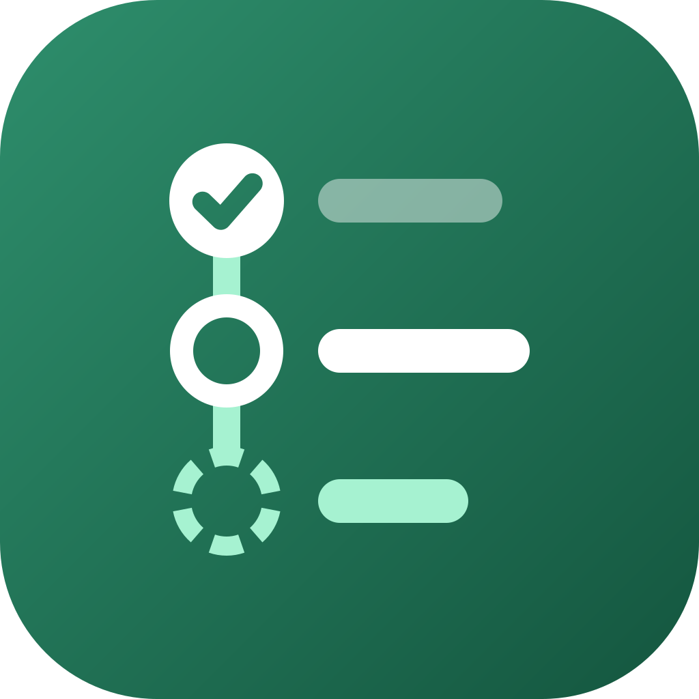
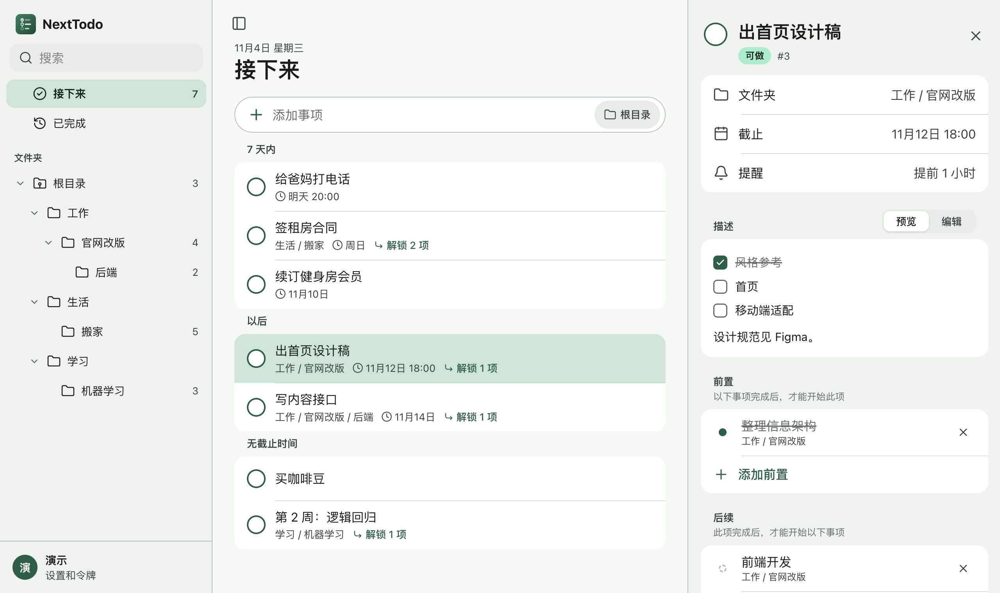
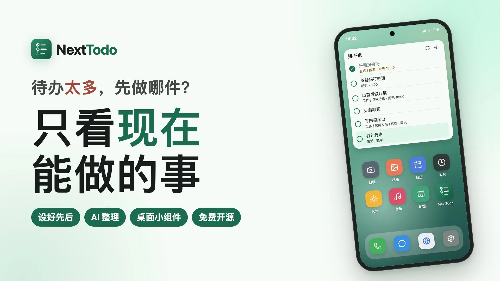
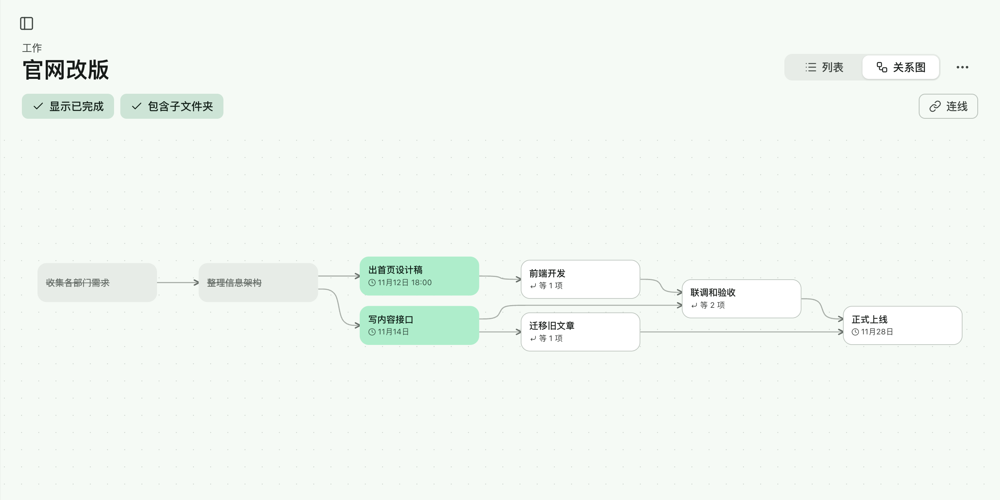
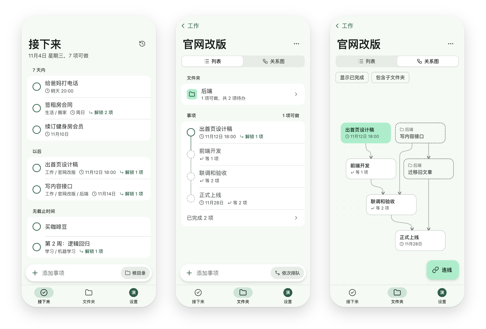

<div align="center">
  
  <h1>NextTodo</h1>
  <p><strong>理清先后，专注当下</strong></p>
  <p>以先后关系为核心的待办应用，可在本机使用，也可自行部署、多端同步</p>
  <p><a href="https://juniexd.github.io/NextTodo/">官网</a> · <a href="https://juniexd.github.io/NextTodo/guide/">快速上手</a> · <a href="https://github.com/JunieXD/NextTodo/releases/latest">下载</a> · <a href="https://qm.qq.com/q/yz6W1Q9NFS">QQ 群</a></p>
  <p>
    <a href="https://github.com/JunieXD/NextTodo/releases/latest"></a>
    <a href="LICENSE"></a>
    
  </p>
</div>

<picture>
  <source media="(prefers-color-scheme: dark)" srcset="docs/images/desktop-dark.webp">
  
</picture>

<p align="center">
  <a href="https://www.bilibili.com/video/BV1adW76wEpD"></a>
  <br>
  <a href="https://www.bilibili.com/video/BV1adW76wEpD">▶ 在 B 站观看视频介绍（2 分钟）</a>
</p>

## 简介

事项之间可以设置依赖，组成一张有向无环图。NextTodo 据此算出每个事项的状态：前置都已完成的可以开始，其余的等待前置。首页随时列出现在能做的事，完成一项，它解锁的后续随即出现。

App 可以只在本机使用，不需要服务器和账号；也可以连接自己部署的服务器，网页、Android、macOS 和 Windows 实时同步，离线时照常使用。agent 可以通过命令行和 MCP 管理全部待办，每次改动都有记录，可以撤销。

## 功能

- **接下来**：汇总所有可以开始的事项，按截止时间分组；每项标出完成后能解锁几项。
- **依赖**：为事项添加前置和后续，形成环的依赖会被拒绝。前置未完成的事项显示为等待中，不进入“接下来”。文件夹列表按先后排列，左侧的轨道画出依赖。
- **关系图**：以图的形式查看一个文件夹里的先后关系，可以直接连线添加依赖。电脑和手机各有一套适合的交互。
- **文件夹**：可以无限嵌套，用来分开不同的项目。
- **截止和提醒**：截止时间可以精确到分钟，也可以每天、每周、每月重复；Android 和桌面 App 到点弹出通知。
- **离线可用**：操作在本地立即生效，联网后同步到所有设备。
- **AI 整理**：把随手写的一大段话交给自己配置的大模型（OpenAI 兼容接口，预设 DeepSeek、通义千问、OpenAI，也可以填其他兼容的地址），在后台整理成带依赖的事项，原文的信息不丢。也可以用自己的话让 AI 整理一个文件夹里的事项：改写、调整先后和截止时间、完成、删除、移动、新建，逐条确认后再应用。配置可以只存在本机，也可以加密保存在服务器上。
- **agent 接入**：命令行、MCP 和 HTTP 接口使用同一组工具，支持一次提交整份计划；令牌分只读和读写。
- **本机模式**：macOS、Windows 和 Android App 可以不连服务器，数据只存在这台设备上，可以备份和恢复。
- **多账号**：管理员生成邀请码，其他人凭邀请码注册，数据彼此独立。
- **Android 小组件和日历**：在桌面查看“接下来”，直接勾选完成或快速添加；带截止时间的事项可以写进系统日历。
- **快速添加**：桌面 App 可以用全局快捷键或菜单栏、托盘图标随时呼出。
- **自动更新**：App 从你的服务器获取更新，版本始终与服务端一致；本机模式从 GitHub Releases 获取。

<picture>
  <source media="(prefers-color-scheme: dark)" srcset="docs/images/graph-dark.webp">
  
</picture>

<picture>
  <source media="(prefers-color-scheme: dark)" srcset="docs/images/phones-dark.webp">
  
</picture>

## 开始使用

### 1. 安装 App

| 平台 | 下载 | 要求 |
|---|---|---|
| Android | [NextTodo-android.apk](https://github.com/JunieXD/NextTodo/releases/latest/download/NextTodo-android.apk) | Android 8.0 及以上 |
| macOS | [NextTodo-macos-arm64.dmg](https://github.com/JunieXD/NextTodo/releases/latest/download/NextTodo-macos-arm64.dmg) | Apple 芯片，macOS 14 及以上 |
| Windows | [NextTodo-windows-x64-setup.exe](https://github.com/JunieXD/NextTodo/releases/latest/download/NextTodo-windows-x64-setup.exe) | Windows 10 或 11，x64 |
| 网页 | 用浏览器打开服务器的域名，可以安装为 PWA | 需要先部署服务端 |

macOS 和 Windows 的安装包没有经过商业签名。macOS 首次打开会被拦下，到“系统设置 → 隐私与安全性”中点击“仍要打开”；Windows 出现 SmartScreen 提示时，点击“更多信息 → 仍要运行”。详见官网的[下载和安装](https://juniexd.github.io/NextTodo/guide/install)。

### 2. 选择用法

App 第一次打开时，在两种用法之间选一种，两者的数据互不相通：

- **在本机使用**：不需要服务器和账号，数据只存在这台设备上，可以备份和恢复。
- **连接服务器**：在多台设备之间同步，也可以用网页版。需要先用 Docker 部署服务端，步骤见官网的[部署服务器](https://juniexd.github.io/NextTodo/guide/server)，细节见[部署文档](docs/deploy.md)。

### 3. 接入 agent

在 App 的设置里生成令牌，页面上会给出填好的 Claude Code、Codex 配置。命令行可以在桌面 App 的设置里一键安装，也可以用安装脚本：

```sh
curl -fsSL https://juniexd.github.io/NextTodo/install.sh | sh
```

详见官网的[接入 agent](https://juniexd.github.io/NextTodo/guide/agent)，工具列表和计划格式见 [agent 接入](docs/agent.md)。

更多用法见[使用教程](https://juniexd.github.io/NextTodo/guide/)。

## 未来计划

打算做、还没开始的：

- **iOS App（不上架 App Store）**：和 Android 一样用 Capacitor 外壳加载网页端，支持本机模式和截止提醒，先不做小组件。发布不签名的 IPA，用户用 SideStore 和自己的 Apple ID 安装，不用花钱，但每 7 天要在手机上续签一次。
- **鸿蒙版**：在纯血鸿蒙（HarmonyOS NEXT）上运行的 App。
- **借 S3 或 WebDAV 同步**：不部署服务器，用 S3 兼容的对象存储或 WebDAV 网盘（如坚果云）在设备之间同步，数据也就有了一份云端的副本。

## 开发

| 做什么 | 命令 |
|---|---|
| 跑全部 Rust 检查 | `cargo fmt --check && cargo clippy --all-targets && cargo test` |
| 启动开发版服务端（`127.0.0.1:8080`） | `cargo run -p nexttodo-server -- --data .dev-data serve` |
| 创建管理员 | `cargo run -p nexttodo-server -- --data .dev-data create-admin <用户名>` |
| 网页端开发（`127.0.0.1:5173`，转发到开发版服务端） | `cd apps/web && pnpm install && pnpm dev` |
| 网页端检查 | `cd apps/web && pnpm check` |
| 安装命令行 `nexttodo` | `cargo install --path crates/cli` |
| 命令行连开发版 | `nexttodo login --url http://127.0.0.1:8080` |
| 构建发布（服务端镜像内容和各端安装包） | `deploy/build.sh` |
| 官网本地预览 | `cd apps/site && pnpm dev` |

Android 和桌面 App 的构建见 [Android](docs/android.md#构建和签名) 和[桌面 App](docs/desktop.md#构建)，发布流程见[部署](docs/deploy.md#构建发布)。参与开发前请先读 [AGENTS.md](AGENTS.md)。

## 文档

| 文档 | 内容 |
|---|---|
| [总体设计](docs/design.md) | 定位、概念和规则、同步、技术栈、部署和更新 |
| [界面](docs/ui.md) | 布局、交互和视觉规范 |
| [数据模型](docs/data-model.md) | 数据库的表和规则 |
| [API](docs/api.md) | REST 接口和同步协议 |
| [agent 接入](docs/agent.md) | 命令行、MCP 和工具接口 |
| [AI 整理](docs/ai.md) | 整理成事项、整理文件夹、模型配置 |
| [本机模式](docs/local.md) | 不连服务器时的做法、备份和恢复 |
| [网页端](docs/web.md) | 前端结构、本地数据和同步 |
| [Android](docs/android.md) | Android App 和小组件 |
| [桌面 App](docs/desktop.md) | macOS 和 Windows App |
| [部署](docs/deploy.md) | 自己部署、升级、备份、构建发布和官网 |

## 交流

QQ 群 1135479637，[点击加入](https://qm.qq.com/q/yz6W1Q9NFS)或用 QQ 扫码：


## 许可证

[MIT](LICENSE)

## 友情链接

<a href="https://linux.do"></a>
