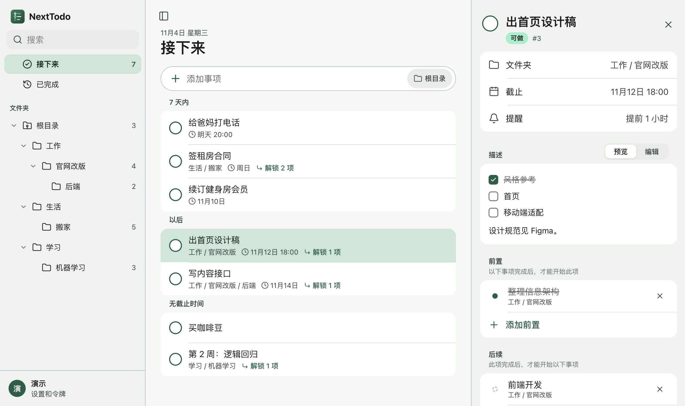
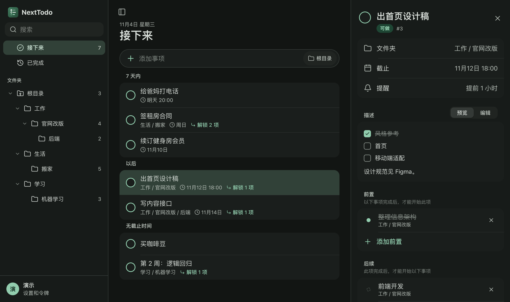
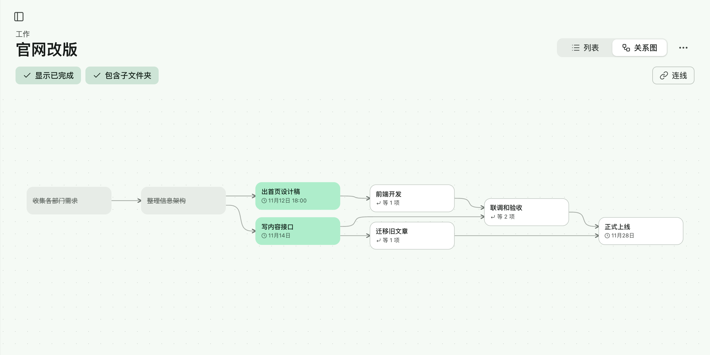
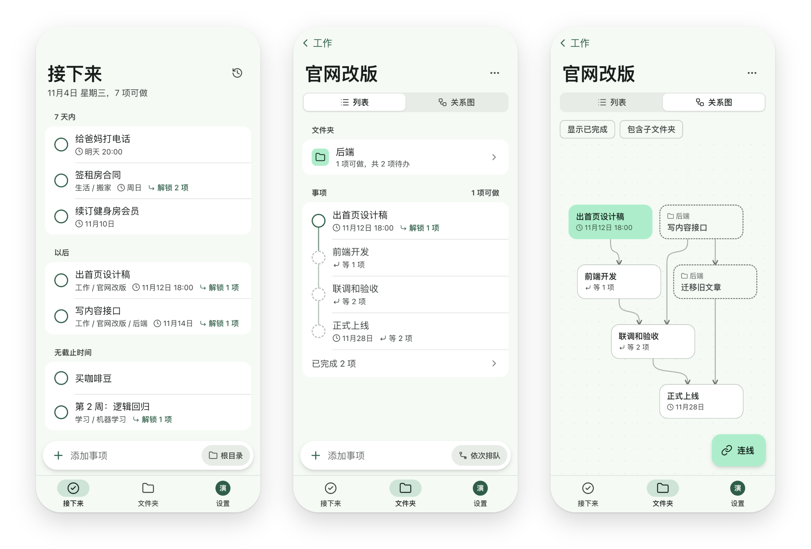
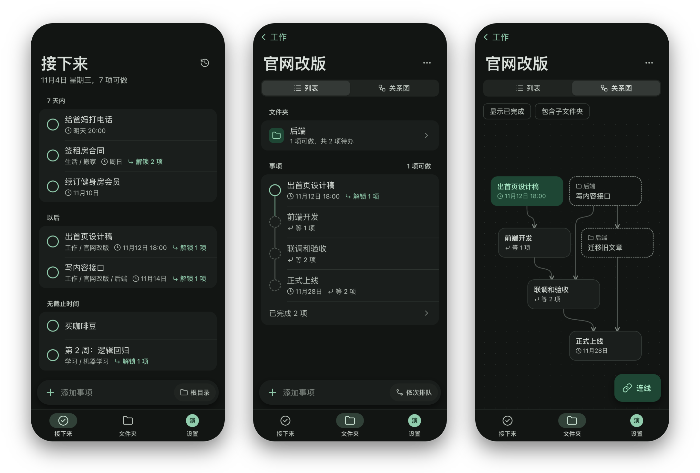

## 视频介绍

<iframe class="video" src="https://player.bilibili.com/player.html?isOutside=true&bvid=BV1adW76wEpD&autoplay=0" loading="lazy" allowfullscreen title="视频介绍：只看现在能做的事"></iframe>

## 电脑上

## 关系图

## 手机上

## 交流群

QQ 群 1135479637，[点击加入](https://qm.qq.com/q/yz6W1Q9NFS)或用 QQ 扫码：

